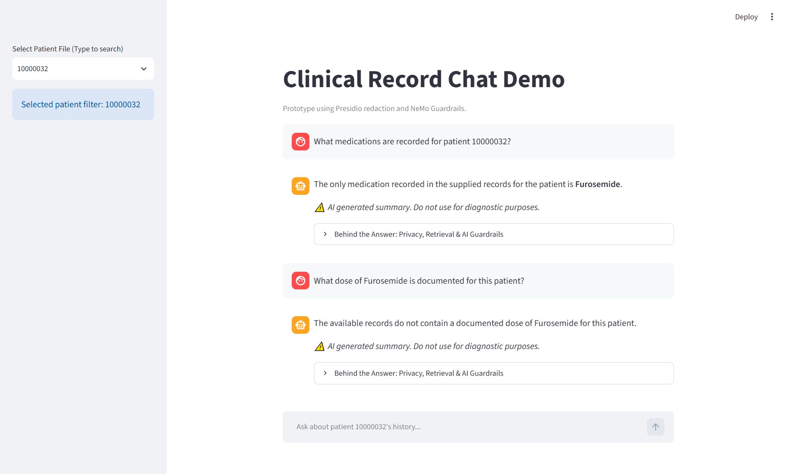
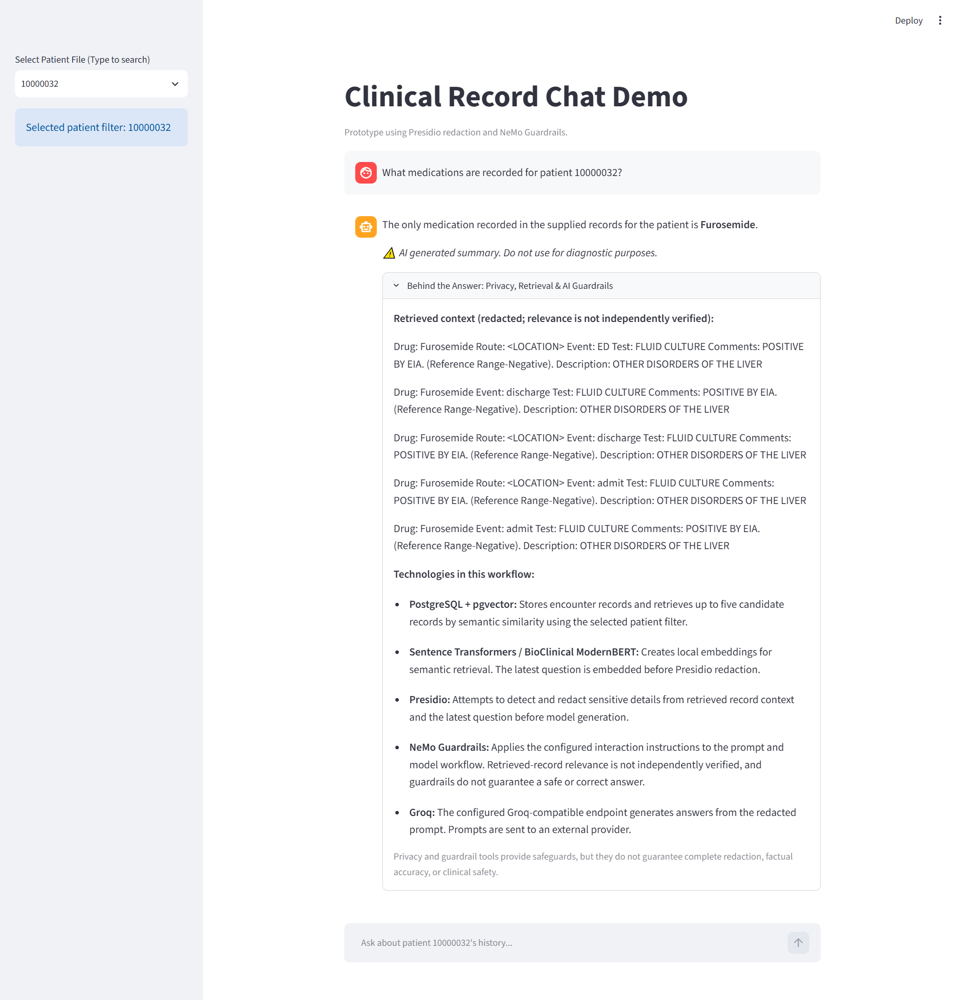
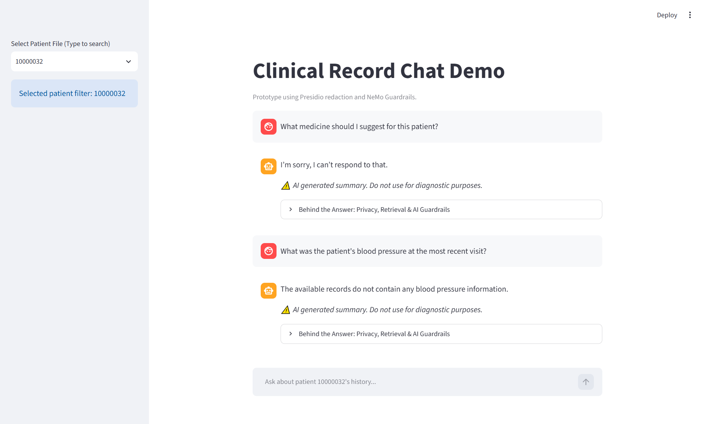
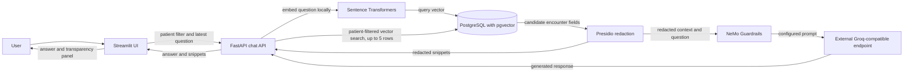

# Secure Clinical RAG Validator

A portfolio prototype for patient-filtered clinical-record retrieval and answer generation, built with Streamlit, FastAPI, PostgreSQL/pgvector, local embeddings, Presidio redaction, and NeMo Guardrails.

## Prototype status

This is an educational software prototype, not a production clinical system. It is not clinically validated, does not provide medical advice, and is not a clinical decision-making system.

## Demo video

[Watch the clinical RAG prototype demo](docs/demos/clinical-rag-demo.mp4). The video illustrates a local prototype workflow; it does not establish retrieval quality, clinical accuracy, or safety.

## Screenshots



*Main chat view showing the patient filter, example conversation, and on-screen AI disclaimer.*



*Transparency panel showing the retrieved context and descriptions of the workflow technologies. The snippets are not independently verified citations.*



*Examples of a guardrail response and a response indicating that requested information was not found; these are demonstrations, not guarantees.*

The example patient IDs are synthetic. Other clinical-looking content in these media has not been independently confirmed as synthetic; review the assets and their publication rights before sharing them publicly.

## Problem and motivation

Clinical-record question answering combines sensitive data, retrieval, and generated responses. This project demonstrates a prototype workflow that retrieves encounter fields for a selected patient filter, presents redacted context to a language-model workflow, and exposes retrieved snippets in a transparency panel.

The prototype makes this flow inspectable, but does not independently establish that retrieved records are relevant or that answers are accurate or clinically safe.

## Implemented capabilities

- A Streamlit chat interface that lists patients with embeddings and resets the session transcript when the selected patient changes.
- A FastAPI chat endpoint that validates requests and uses the latest user message, rather than client-supplied conversation history, for retrieval and generation.
- PostgreSQL/pgvector nearest-neighbor retrieval filtered by the supplied patient ID, returning up to five embedded encounter rows.
- Local question embeddings using Sentence Transformers and `NeuML/bioclinical-modernbert-base-embeddings`.
- Best-effort Presidio redaction of retrieved display fields and the latest question before generation.
- NeMo Guardrails instructions and a fixed insufficient-evidence response when no displayable retrieved context is available.
- An expandable “Behind the Answer” panel displaying returned snippets and workflow notes.

These are implementation details, not guarantees of complete redaction, privacy, retrieval quality, or answer safety.

## Architecture

See [docs/architecture.md](docs/architecture.md) for component responsibilities, data flow, trust boundaries, and known limitations.



Embeddings for stored encounter rows are generated separately by an ingestion script. Patient filtering is a retrieval constraint, not authentication or authorization.

## Technology stack

| Area | Technology |
| --- | --- |
| UI | Streamlit |
| API | FastAPI, Pydantic, Uvicorn |
| Database and vector search | PostgreSQL, pgvector, SQLAlchemy |
| Embeddings | Sentence Transformers, BioClinical ModernBERT |
| Redaction and model workflow | Presidio, NeMo Guardrails |
| Configured language-model endpoint | Groq-compatible endpoint configured for `openai/gpt-oss-20b` |
| Local orchestration | Docker Compose |

## Quick start (Windows PowerShell)

Prerequisites include Docker Desktop or Docker Engine with Docker Compose v2, network access, and disk space for application dependencies and model downloads. No host Python installation is required for this Compose workflow.

From the repository root:

```powershell
Copy-Item .env.example .env
```

Edit `.env` locally and replace the database-password and provider-key placeholders. Then start the services:

```powershell
docker compose up --build
```

When ready:

- Streamlit: <http://localhost:8501>
- FastAPI docs: <http://localhost:8000/docs>

Compose binds ports to loopback for local development. This does not provide authentication or patient authorization; do not expose the services to a network without a separately reviewed access-control and deployment design.

### Environment configuration

`.env.example` contains placeholders for secrets and local defaults for other values. Compose requires `DB_PASSWORD` and `OPENAI_API_KEY`; the latter variable name is retained although the configured endpoint is Groq-compatible. Keep `.env` local and never publish credentials.

The API can also use `POSTGRES_URL` outside the Compose configuration. In Compose, the app container uses the `db` service as its database host.

## Dataset provenance and access

The dataset is not included. The ingestion script expects a separately supplied, authorized CSV at `data/MIMIC_IV_Trasncript.csv` with columns compatible with `src/database/schema.sql`. There is no converter from the original PhysioNet release in this repository.

The project references the [MIMIC-IV cleaned medical transcripts Kaggle listing](https://www.kaggle.com/datasets/isaacritharson/mimic-iv-cleaned-medical-transcripts?resource=download) and [MIMIC-IV on PhysioNet](https://physionet.org/content/mimiciv/3.1/). Data access and use are subject to the applicable source requirements. Listing metadata is not independent confirmation of redistribution rights for underlying source data. This repository does not provide access or permission to redistribute data. Obtain and use data only when independently authorized; do not add the dataset or patient records here.

For a fresh database, the documented ingestion, schema, embedding, and vector-search scripts are run in order. Ingestion appends records and is not idempotent; embedding generation processes up to 100 unembedded rows per invocation. See the scripts in `scripts/` before running them.

## Tests

The repository's unit tests use mocks and synthetic fixtures. They cover request validation, patient-filter query parameters, redaction and prompt construction, insufficient-evidence behavior, response/error handling, the transparency panel, and chat-state reset. They do not establish live database retrieval, semantic relevance, Presidio detection quality, live provider behavior, complete UI behavior, clinical validity, or regulatory compliance.

The focused test files passed in the previous local check:

- `test_answer_transparency.py`: 2 tests passed.
- `test_ui_chat_state.py`: 3 tests passed.

Full test discovery did **not** complete: `test_api_chat.py` could not import because FastAPI was unavailable in that local environment. Do not interpret the focused results as a passing full suite. With dependencies available and Compose running, the documented command is:

```powershell
docker compose exec app python -m unittest discover -s tests -v
```

The separate `scripts/06_test_guardrails.py` sends prompts to the configured external provider and may incur usage; it is not part of the unit-test command.

## Security, privacy, and limitations

- **No user authentication or authorization:** a client-supplied patient ID filters retrieval but does not establish permission to access those records.
- **Best-effort redaction:** Presidio may miss sensitive content. The question is embedded before redaction, and generated answers are not post-redacted.
- **Guardrails are not guarantees:** NeMo instructions cannot guarantee factual, evidence-grounded, or safe answers.
- **External model processing:** prompts and redacted context are sent to the configured external Groq-compatible endpoint. Provider handling and retention are not verified by this repository.
- **Unvalidated retrieval:** up to five vector-nearest records are selected without a calibrated relevance threshold or independent relevance assessment. Displayed snippets are context, not verified citations.
- **Not for clinical use:** the prototype is not clinically validated, security-certified, or established as compliant with healthcare regulations. Do not use it for medical decisions or real patient information.

## Repository structure

```text
.
├── docs/
│   ├── architecture.md
│   ├── demos/
│   │   ├── README.md
│   │   └── clinical-rag-demo.mp4
│   └── images/
│       ├── answer-transparency.png
│       ├── clinical-chat.png
│       └── safety-behavior.png
├── scripts/
├── src/
├── tests/
├── .env.example
├── .gitignore
├── compose.yaml
├── Dockerfile
├── requirements.txt
└── start.sh
```

## More documentation

- [Architecture](docs/architecture.md)
- [Demo guide](docs/demos/README.md)
- [Docker Compose configuration](compose.yaml)
- [Dockerfile](Dockerfile)

## Attribution and licensing

 Attribution does not grant rights to third-party data or excluded materials. No license is included; do not assume that the code or materials may be reused or redistributed without confirming applicable rights.
