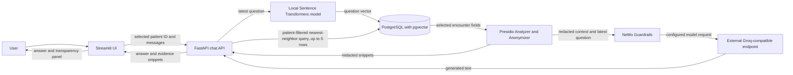

# Architecture

This document describes the implemented chat path and separates it from the prototype's data-preparation scripts and mock endpoint.

## Chat request and response

The Streamlit app in `src/ui/app.py` requests available patient IDs and sends the selected ID plus its chat messages to the FastAPI service. The API validates the message structure and patient ID. For retrieval and generation, it uses only the latest user message; prior messages supplied by the client are not included in the model prompt.

The selected patient ID is a query filter, not an identity or authorization check. The patient-list endpoint returns IDs for records that have embeddings and has no authentication layer.

## Retrieval and database

The API embeds the latest question with the locally loaded Sentence Transformers model `NeuML/bioclinical-modernbert-base-embeddings`. It queries `patient_encounters` in PostgreSQL using pgvector cosine distance, filters rows by `subject_id`, and selects up to five nearest records with embeddings. The query's field selection includes drug, dose, route, event type, test name, comments, and description.

This is a nearest-neighbor selection, not a relevance guarantee. There is no calibrated similarity threshold, independent relevance evaluation, or verified citation mechanism. If no returned rows contain displayable fields, the API returns a fixed insufficient-evidence response without calling the model.

## Redaction and generation

For rows with displayable fields, the API assembles snippets and runs them through the Presidio Analyzer and Anonymizer service before using them as prompt context or returning them as evidence. It also redacts the latest question before generation. The question embedding is computed before this redaction step. Presidio uses configured entity types and custom patterns; detection is best effort, and no post-generation redaction is implemented.

The API sends a single prompt containing the redacted retrieved context, the redacted latest question, and instructions to NeMo Guardrails. The guardrails configuration names `openai/gpt-oss-20b` and sets a Groq-compatible OpenAI API base URL. The resulting request is processed by an external provider. This repository does not establish the provider's retention, handling, or data-use practices.

Guardrail instructions ask for answers limited to supplied context and for refusal of treatment recommendations or diagnoses. They do not prove that a response follows those instructions, is accurate, or is safe.

## UI transparency

The UI displays the generated answer and, when the API returns evidence, an expandable “Behind the Answer” panel with the redacted snippets and descriptions of the technologies involved. These snippets show the retrieved context used by the application; they are not independently validated as relevant or as citations supporting every answer statement.

Changing the selected patient clears the chat transcript in the Streamlit session. This UI behavior does not provide server-side authentication or authorization.

## Data preparation

The separate scripts expect a locally available `data/MIMIC_IV_Trasncript.csv`, create/verify the database schema, add the pgvector embedding column, and generate embeddings for up to 100 unembedded records per run. The CSV is not included. The ingestion script appends data, and the embedding script computes vectors locally from selected encounter fields. These scripts do not demonstrate that input data has been de-identified or that its use is authorized.

## Other API route

`POST /api/v1/clinical-query` is a separate mock route in `src/api/main.py`. It constructs fixed synthetic context, redacts the prompt and context, and calls the configured guardrails workflow. The Streamlit chat interface does not call this route; its database retrieval flow uses `POST /api/v1/chat`.

## Mermaid flow

## Trust boundaries and limitations

- The browser-facing app and API have no authentication or patient authorization. The client-selected patient ID is not proof of access rights.
- Encounter data and embeddings reside in PostgreSQL. The embedding model runs locally in the application container; raw input fields can be used to create stored embeddings.
- Presidio redaction and NeMo Guardrails are safeguards, not guarantees. Sensitive content may remain in input, context, or generated output.
- The prompt is sent to an external model endpoint. Provider handling and retention are outside this repository's verified behavior.
- The vector search does not establish clinical relevance; the answer may be incomplete, unsupported, or wrong.
- The system is an educational prototype, not medical advice, a clinical decision-making system, a production service, or a clinically validated or compliance-certified product.
